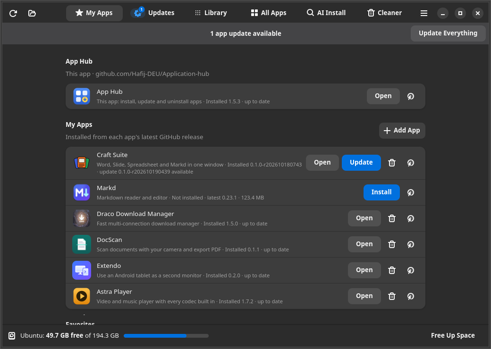
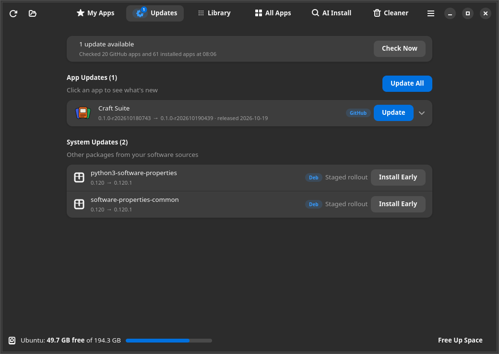
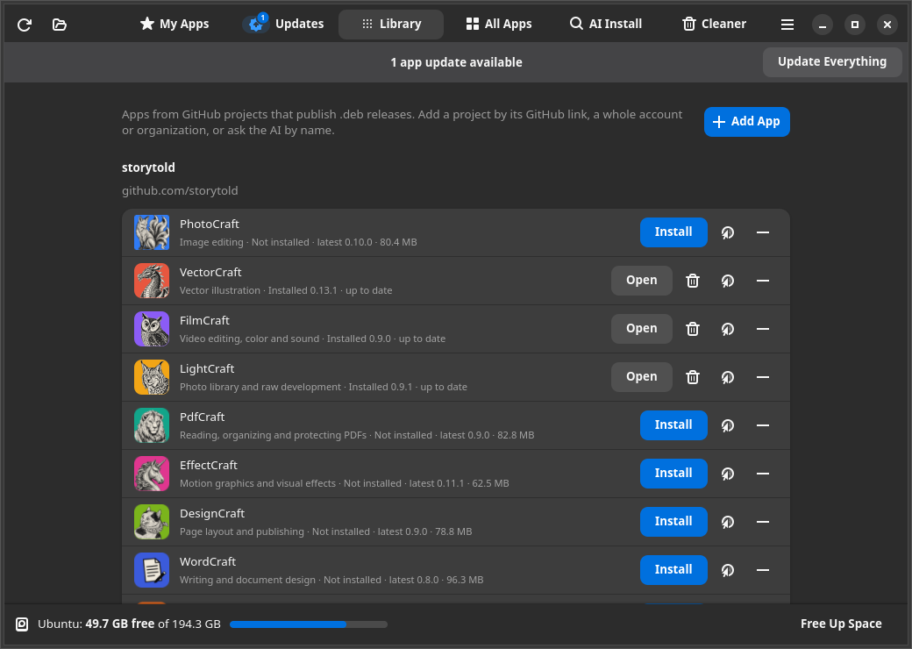

<div align="center">


# App Hub

**One window to install, update and remove every app on Ubuntu:** GitHub releases, apt, Snap,
Flatpak and AppImage, with a single password prompt for everything.

[](https://github.com/Hafij-DEU/Application-hub/releases/latest)
[](https://github.com/Hafij-DEU/Application-hub/releases)


[**Download**](https://github.com/Hafij-DEU/Application-hub/releases/latest) ·
[Features](#features) · [Install](#install) · [Command line](#command-line) · [How it works](#how-it-works)



</div>

## Features

| | |
|---|---|
| **My Apps** | Installs and updates apps straight from their latest GitHub release, plus GNOME Shell extensions in its **Extensions** group. **Add App** (admin only) adds more: paste a repo link, or an account link to list every project that publishes a `.deb`. |
| **Updates** | Checks GitHub, Deb, Snap, Flatpak and system packages, and lists every pending update with old → new version and release notes. Update one app, or everything at once. The tab shows how many updates are waiting. |
| **Library** | Any GitHub project with `.deb` releases, grouped by owner. Starts with 13 creative apps from [storytold](https://github.com/storytold) (PhotoCraft, VectorCraft, FilmCraft, …). Add more by link, by account, or by name with AI. |
| **All Apps** | Every installed desktop app with its channel (Deb, Snap, Flatpak, AppImage). Update, open, star or uninstall each one. **Recently Uninstalled** brings back anything removed in the last 60 days, by any tool. |
| **AI Install** | Ask Gemini how to install an app. Every answer is checked locally (apt cache, Snap Store, Flatpak remote, GitHub) before you confirm. Commands written by the AI are never run. |
| **Cleaner** | Finds what removed apps left behind: folders in your home (moved to the Trash, not deleted), config files, unused dependencies, old snap revisions, unused Flatpak runtimes and cached `.deb` files. |

And more:

- 🔐 **One password for everything.** All root work goes into one plan, so Update Everything asks
  once. One failing app does not stop the others.
- 💽 **Free space at a glance.** The bottom bar shows free space on the Ubuntu disk (and `/home` if
  it is separate), with **Free Up Space** to open the Cleaner.
- 📦 **Install any `.deb`.** Double-click a `.deb` file or use the open button. App Hub shows the
  version change and size, then installs it with `apt`, so dependencies come along.
- ⭐ **Favorites.** Star apps, then install them all on a new machine with one click.
- 🧭 **Ubuntu staged updates.** Phased (staged-rollout) updates are listed separately and can be
  installed early if you choose.
- 🎨 **Native look.** GTK 4 and libadwaita, following your system's light/dark style and accent color.

<table>
  <tr>
    <td></td>
    <td></td>
  </tr>
  <tr>
    <td align="center"><b>Updates</b>: every pending update, one by one or all at once</td>
    <td align="center"><b>Library</b>: GitHub projects with <code>.deb</code> releases</td>
  </tr>
</table>

## Install

Run this one command. It downloads the latest release and installs it:

```bash
url=$(curl -fsSL https://api.github.com/repos/Hafij-DEU/Application-hub/releases/latest | grep -o 'https://[^"]*_all\.deb' | head -1) && curl -fL "$url" -o /tmp/app-hub.deb && sudo apt install -y /tmp/app-hub.deb
```

Or install by hand: download `app-hub_<version>_all.deb` from the
[latest release](https://github.com/Hafij-DEU/Application-hub/releases/latest), then run
`sudo apt install ./app-hub_*_all.deb`.

Requires Ubuntu 24.04 or newer, or Debian 13 (Python 3.10+, GTK 4.14+, libadwaita 1.5+).
Snap and Flatpak support turns on when `snapd` or `flatpak` is installed.
From then on, App Hub updates itself from its own row at the top of My Apps.

### Apps in My Apps

| App | What it is | Repository |
|---|---|---|
| Craft Suite | Word, Slide, Spreadsheet and Markd in one window | [Hafij-BGE/software](https://github.com/Hafij-BGE/software) |
| Markd | Markdown reader and editor | [Hafij-BGE/markd](https://github.com/Hafij-BGE/markd) |
| Draco Download Manager | Fast multi-connection download manager | [Hafij-BGE/draco-dm](https://github.com/Hafij-BGE/draco-dm) |
| DocScan | Scan documents with your camera and export PDF | [Hafij-DEU/Scan](https://github.com/Hafij-DEU/Scan) |
| Extendo | Use an Android tablet as a second monitor | [Hafij-BGE/Second-monitor](https://github.com/Hafij-BGE/Second-monitor) |
| Astra Player | Video and music player with every codec built in | [Hafij-DEU/video-player](https://github.com/Hafij-DEU/video-player) |
| Toggle Internal Keyboard | Turn the laptop keyboard on/off; auto-fix stuck Shift | [Hafij-DEU/laptop-keyboard-toggle](https://github.com/Hafij-DEU/laptop-keyboard-toggle) |

### Extensions in My Apps

GNOME Shell extensions, installed from the `.zip` on each latest release. Log out and back
in after installing or updating one.

| Extension | What it is | Installed | Repository |
|---|---|---|---|
| Fusion Desk | Taskbar, start menu and widgets in one panel | For your user, no password | [Hafij-DEU/Fusion-desk-gnome-extension](https://github.com/Hafij-DEU/Fusion-desk-gnome-extension) |
| Sign-In Button | Clickable sign-in arrow on the login and lock screens | System-wide and on the login screen (asks for your password) | [Hafij-DEU/gnome-signin-button](https://github.com/Hafij-DEU/gnome-signin-button) |

## Setup tips

**GitHub sign-in (recommended).** Without it, GitHub allows only 60 update checks per hour per
network. App Hub uses your GitHub CLI login (`gh auth login`) automatically, or a token saved in
**Menu ▸ Preferences** (it needs no permissions); either raises the limit to 5000. When GitHub
can't be reached, App Hub shows its last answer and says so.

**Add App in My Apps (admin).** The **Add App** button in My Apps appears only after the admin
PIN is entered in **Menu ▸ Preferences ▸ Admin**; **Lock** hides it again. Admin mode also shows a **Downloads** section in My Apps: how often
each release of every app and extension was downloaded from GitHub (your own installs
included), also as `app-hub downloads`. The Library's own Add App is open to everyone. The maintainer sets the PIN with `./set-admin-pin.py`; only a
salted hash is stored.

**AI Install.** Add a free Gemini API key in **Menu ▸ Preferences**
([get one here](https://aistudio.google.com/apikey)), or set `GEMINI_API_KEY`.

**Open a page directly.** `app-hub --page updates` opens the Updates page, or switches the open
window to it. The launcher's right-click menu has the same **Updates** shortcut, which the
Fusion Desk panel uses for its "App Update" item.

## Command line

Everything in the window also works from a terminal:

| Command | What it does |
|---|---|
| `app-hub` | Open the window (`--page updates\|my-apps\|library\|all-apps\|ai\|cleaner`) |
| `app-hub list [--json]` | Your GitHub apps: installed vs latest |
| `app-hub install markd` · `update [APP…]` · `remove extendo` | Manage GitHub apps |
| `app-hub update-all [--apps-only] [--include-phased] [-y]` | Update everything with one password |
| `app-hub update-all --dry-run [--json]` | List pending app and system updates; install nothing |
| `app-hub apps [--channel snap] [--no-updates]` | Every installed app with channel and updates |
| `app-hub recent` | Recently uninstalled apps |
| `app-hub downloads [--releases N] [--json]` | Download counts of your apps' releases (admin) |
| `app-hub add [--mine] owner/repo` | Add a GitHub project to the Library (or to My Apps; asks for the admin PIN) |
| `app-hub install-deb FILE.deb` | Install a local `.deb` with its dependencies |
| `app-hub ai "pdf editor"` | Ask Gemini; every suggestion is verified |
| `app-hub favorites` | List favorite apps |

## How it works

**Root access.** Everything that needs root goes through `/usr/lib/app-hub/app-hub-helper`,
started with `pkexec` under the polkit action `io.github.hafij_bge.AppHub.manage`. The helper
takes a JSON list of steps (`install-deb`, `apt-upgrade`, `snap-refresh`, `flatpak-update`, …) and
checks every package, snap, ref and channel name against a strict pattern, so nothing can be
passed in as an option. `app-hub-helper --simulate PLAN` prints the commands and runs apt in
simulate mode.

**GitHub releases.** App Hub picks the `.deb` asset that fits this machine (architecture first,
then a build for this exact distro version, then a generic one) and verifies its SHA-256 against
GitHub's digest or a `SHA256SUMS` file. To add a project, it reads the package name from the
`.deb` header with an HTTP range request, so nothing big is downloaded. If the newest release has
no `.deb` for this system, it offers the newest one that does. Answers are cached with ETags, so
unchanged checks don't count against the rate limit.

**Your files.**

| Path | Contents |
|---|---|
| `~/.config/app-hub/settings.json` | Gemini key and model, GitHub token (readable only by you) |
| `~/.config/app-hub/library.json` | Apps you added, and default Library apps you removed |
| `~/.local/share/app-hub/` | Favorites, uninstall history, Library icons |
| `~/.cache/app-hub/` | GitHub answers and downloaded releases |

## Build from source

```bash
git clone https://github.com/Hafij-DEU/Application-hub.git
cd Application-hub
./build-deb.sh          # creates dist/app-hub_<version>_all.deb
```

The app is plain Python in `src/app_hub/`: `gui.py` is the window, `cli.py` the terminal front
end, `core.py` the GitHub and dpkg logic, and `inventory.py` lists apps across channels.
`src/app-hub-helper` is the root helper, `src/catalog.json` lists the My Apps entries and
`src/library-default.json` the default Library.

## Credits

The Library's default app icons (PhotoCraft, VectorCraft, FilmCraft, LightCraft, PdfCraft,
EffectCraft, DesignCraft, WordCraft, DeckCraft, GridCraft, CADCraft, SoundCraft, FigCraft) come from
the [storytold](https://github.com/storytold) repositories and are used under the Apache License 2.0.
