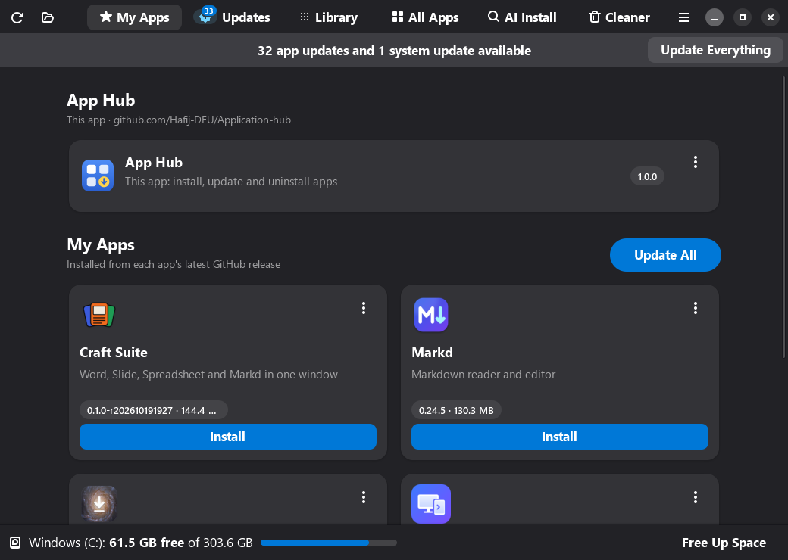
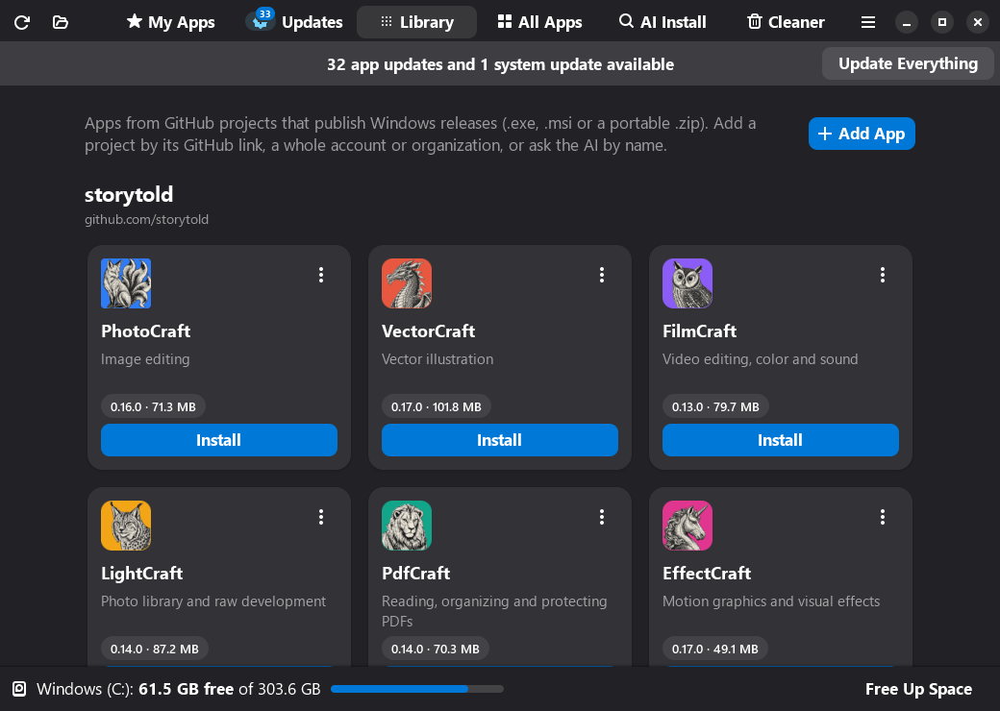

<div align="center">


# App Hub for Windows

**One window to install, update and remove every app on Windows 11:** GitHub releases, winget
and the Microsoft Store, with an IObit-style uninstaller and a single administrator prompt for everything.


[](https://github.com/Hafij-DEU/Application-hub/releases/download/windows-v1.0.3/AppHubSetup-1.0.3.exe)

[Release notes](https://github.com/Hafij-DEU/Application-hub/releases/tag/windows-v1.0.3) ·
[Features](#features) · [Install](#install) · [Command line](#command-line) · [How it works](#how-it-works)



</div>

The Windows version of [App Hub for Ubuntu](https://github.com/Hafij-DEU/Application-hub): the
same window, tabs and cards, built on Windows' own ways of installing software.

## Features

| | |
|---|---|
| **My Apps** | App cards with icon, status and one button: installs and updates apps straight from their latest GitHub release (Craft Suite, Markd, Draco, Extendo). Only apps with a Windows build are shown. |
| **Updates** | Checks GitHub and winget, and lists every pending update with old → new version and release notes. Update one app, or everything at once. Also shows whether Windows Update has updates waiting. |
| **Library** | Any GitHub project with Windows releases (`.exe`, `.msi` or a portable `.zip`), as cards grouped by owner. Starts with 13 creative apps from [storytold](https://github.com/storytold). Add more by link, by account, or by name with AI. |
| **All Apps** | Every installed app, as Settings ▸ Apps lists them, plus Microsoft Store apps and portable apps, with their real icons. Update, open, open the install folder, star or uninstall each one. **Recently Uninstalled** brings back anything removed in the last 60 days, by any tool. |
| **Uninstaller** | Thorough removal like IObit Uninstaller: optional restore point, the app's own uninstaller (silently when it can), then a **Powerful Scan** for leftovers: folders, registry keys, shortcuts, services and scheduled tasks. **Force Removal** when an uninstaller is missing or fails. Select several apps in All Apps to remove them in one go. Registry keys are saved to a `.reg` backup first; folders go to the Recycle Bin. |
| **AI Install** | Ask Gemini how to install an app. Every answer is checked locally (winget, Microsoft Store, GitHub, the download link) before you confirm. Commands written by the AI are never run. |
| **Cleaner** | Finds folders removed apps left in AppData, ProgramData and Program Files, broken shortcuts, temporary files, crash dumps, Windows temporary files, Windows Update downloads and the Recycle Bin. Folders go to the Recycle Bin, not deleted. |

And more:

- 🔐 **One prompt for everything.** All work that needs administrator rights goes into one plan,
  so Update Everything asks once. Apps installed only for you update without any prompt. One
  failing app does not stop the others.
- 💽 **Free space at a glance.** The bottom bar shows free space on the Windows drive, with
  **Free Up Space** to open the Cleaner.
- 📦 **Install any program file.** Open an `.exe`, `.msi`, `.msix` or portable `.zip`: App Hub shows
  what kind of installer it is, its version and who signed it, then installs it silently when it can.
- 🗂️ **Portable apps become real apps.** A `.zip` or single `.exe` release is unpacked to
  `%LOCALAPPDATA%\Programs\App Hub Apps`, with a Start menu shortcut and an entry in Settings ▸ Apps.
- ⭐ **Favorites.** Star apps, then install them all on a new PC with one click.
- 🎨 **Native look.** GTK 4 and libadwaita, following the Windows light/dark setting and accent colour.

<p align="center"><br>
<b>Library</b>: GitHub projects with Windows releases</p>

## Install

Download `AppHubSetup-<version>.exe` from the
[Windows release](https://github.com/Hafij-DEU/Application-hub/releases/tag/windows-v1.0.3) and run it.
SmartScreen may warn because the app isn't code-signed: **More info → Run anyway**.
The installer asks for administrator permission once and installs App Hub for all users. From then
on, App Hub updates itself from its own card at the top of My Apps.

Requires Windows 10 1809 or newer (made for Windows 11), x64 or ARM64 (x64 build).
**winget** ("App Installer", included in Windows 11) adds updates for all your other apps.

## Setup tips

**GitHub sign-in (recommended).** Without it, GitHub allows only 60 update checks per hour per
network. App Hub uses your GitHub CLI login (`gh auth login`) automatically, or a token saved in
**Menu ▸ Preferences** (it needs no permissions); either raises the limit to 5000.

**AI Install.** Add a free Gemini API key in **Menu ▸ Preferences**
([get one here](https://aistudio.google.com/apikey)), or set `GEMINI_API_KEY`.

**Open a page directly.** `AppHub.exe --page updates` opens the Updates page, or switches the open
window to it. The Start menu has an **App Hub Updates** shortcut that does this.

## Command line

`app-hub.exe` (next to `AppHub.exe`) does everything from a terminal:

| Command | What it does |
|---|---|
| `app-hub list [--json]` | My Apps and Library: installed vs latest |
| `app-hub install markd` · `update [APP…]` | Install or update GitHub apps |
| `app-hub update-all [-y] [--dry-run] [--json]` | Every app update plus winget, one administrator prompt |
| `app-hub apps [--json] [--updates]` | Every installed app with its updates |
| `app-hub recent` | Recently uninstalled apps |
| `app-hub add owner/repo` | Add a GitHub project to the Library |
| `app-hub ai "pdf editor"` | Ask Gemini; every suggestion is verified |
| `app-hub favorites` | List favorite apps |

## How it works

**Administrator rights.** Everything that needs them goes through App Hub itself, started once
with UAC as `AppHub.exe --helper PLAN`. The plan is a JSON list of steps (`install`, `uninstall`,
`winget`, `clean`, `recycle`, …). The helper checks every step: installers must come from App Hub's
own download folder, uninstall commands are read from the registry by the helper itself, winget ids
must match a strict pattern, and the Cleaner may only recycle folders under AppData, ProgramData or
Program Files that are not part of Windows.

**GitHub releases.** App Hub picks the Windows file that fits this PC: an installer before a
portable `.zip`, this machine's architecture before another one (x64 builds run on ARM64). It
verifies the SHA-256 against GitHub's digest or a `SHA256SUMS` file. If the newest release has no
Windows build, it offers the newest one that does. Answers are cached with ETags, so unchanged
checks don't count against the rate limit.

**Installers.** App Hub recognises Inno Setup, NSIS, WiX, Squirrel and Windows Installer (`.msi`)
files and runs them silently. Apps installed only for you are updated without a prompt; apps
installed for all users go into the elevated plan. Installers it does not recognise open their own
window.

**Installed apps.** All Apps reads the Uninstall registry keys (what Settings ▸ Apps shows), the
Start menu and the Microsoft Store packages. `winget list` adds package ids and available updates.
Windows keeps no log of removed programs, so App Hub remembers what was installed and notices
what disappeared since, whatever removed it.

**Your files.**

| Path | Contents |
|---|---|
| `%APPDATA%\App Hub\settings.json` | Gemini key and model, GitHub token, theme |
| `%APPDATA%\App Hub\library.json` | Apps you added, and default Library apps you removed |
| `%LOCALAPPDATA%\App Hub\` | Favorites, uninstall history, icon cache |
| `%LOCALAPPDATA%\App Hub\cache\` | GitHub answers and downloaded installers |
| `%LOCALAPPDATA%\App Hub\registry-backups\` | `.reg` copies of registry keys the uninstaller deleted (double-click to restore) |
| `%LOCALAPPDATA%\Programs\App Hub Apps\` | Portable apps App Hub unpacked |

## Build from source

Needs [MSYS2](https://www.msys2.org) and [Inno Setup 6](https://jrsoftware.org)
(`winget install MSYS2.MSYS2 JRSoftware.InnoSetup`). Then, in PowerShell:

```powershell
git clone https://github.com/Hafij-DEU/Application-hub.git
cd Application-hub\windows
powershell -ExecutionPolicy Bypass -File packaging\windows\build.ps1   # dist\AppHubSetup-<version>.exe
```

Windows releases are tagged `windows-v<version>` and carry `AppHubSetup-<version>.exe`; App Hub finds its
own updates by that file name, next to the Linux `.deb` releases of this repository.

To run it from source: `C:\msys64\ucrt64\bin\pythonw.exe bin\app-hub.pyw` (with `C:\msys64\ucrt64\bin`
on `PATH`). The app is plain Python in `src/app_hub/`: `gui.py` is the window, `cli.py` the terminal
front end, `core.py` the GitHub logic, `inventory.py` lists installed apps, `installer.py` runs
installers, `helper.py` the elevated plan runner and `winsys.py` the Windows calls. `src/catalog.json`
lists the My Apps apps and `src/library-default.json` the default Library.

`APP_HUB_SNAPSHOT=folder` saves every tab as a PNG and quits (used for the screenshots above).

## Credits

The Library's default app icons come from the [storytold](https://github.com/storytold)
repositories and are used under the Apache License 2.0.
